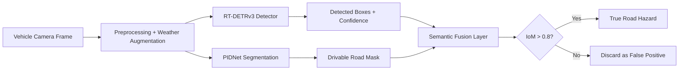

# RoadAware-DETR
Context-Aware Pothole Detection Using RT-DETRv3 and PIDNet Semantic Fusion

## Overview
This repository presents a semester research project named RoadAware-DETR, which combines an RT-DETRv3-based object detection stream with a PIDNet-based semantic segmentation stream to validate whether detected potholes or cracks lie on the actual drivable road surface. The core idea is to reduce false positives caused by off-road anomalies and improve road hazard reliability in autonomous driving scenarios.

The project is motivated by the problem of spatial blindness in conventional road damage detectors. A model may correctly detect a pothole-like pattern visually, but if it is on a sidewalk, shoulder, median, or other non-drivable region, it should not trigger a vehicle warning or emergency braking decision. The proposed fusion layer aims to enforce road context before accepting a detection as a valid hazard.

## Project Status and Scope
This repository is a research prototype and academic project implementation inspired by the RT-DETRv3 detection framework and PIDNet segmentation approach. It is intended for experimentation, documentation, and semester project development.

Important clarification:
- This project is not claiming benchmark-level validated numbers from a published paper.
- The numerical results mentioned in the project presentation were not supplied in the extracted PDF content, so no fabricated results are included here.
- The documentation follows the methodology described in the project slides and focuses on the proposed approach rather than confirmed final experiment outcomes.

## Motivation
Modern transportation systems depend heavily on safe, reliable road infrastructure. Cracks, potholes, and road deterioration can impact vehicle safety, travel comfort, and long-term transportation costs. However, existing automated road inspection and autonomous perception systems often lack spatial awareness and may detect visually similar defects in irrelevant regions.

This leads to a serious safety issue: false positives in non-drivable areas may trigger unnecessary warnings or emergency braking. This phenomenon is commonly described as phantom braking. A system that does not know whether the object is on the road can mistakenly classify harmless off-road features as urgent hazards.

## Problem Statement
Current road-damage detection systems often achieve strong visual detection performance, but their reliability decreases when deployed in real-world scenes. These detectors may localize damage features accurately while failing to determine whether the detected object is actually located on the drivable area.

This spatial blindness creates several risks:
- Detecting cracks on sidewalks, medians, or dirt shoulders as if they were on-road hazards.
- Triggering false alarms from off-road objects that are irrelevant to vehicle motion.
- Causing unsafe braking decisions or phantom braking in autonomous navigation systems.

The project addresses this by combining detection with road-context reasoning.

## Research Objective
The primary objective of RoadAware-DETR is to improve pothole and crack detection reliability by enforcing road-surface validity before accepting a hazard. The model should decide not only whether an object looks like a pothole, but also whether the detected object lies on the drivable road.

## Core Idea
RoadAware-DETR is a dual-stream pipeline:

1. Detection stream: RT-DETRv3 identifies potholes, cracks, and other structural damage patterns and outputs bounding boxes and confidence scores.
2. Context stream: PIDNet predicts a pixel-wise drivable-road mask to identify the region of the image that belongs to the road surface.
3. Fusion layer: Each predicted box is projected onto the drivable-road mask, and the overlap is measured to decide whether the detection is valid.

This approach is designed to reject false positives located outside the drivable region while preserving legitimate on-road detections.

## Proposed System Pipeline
The system follows a context-aware fusion process:

- Input image acquisition from a vehicle-mounted camera or dashcam.
- Preprocessing and augmentation for adverse weather conditions.
- RT-DETRv3 detection of potholes/cracks.
- PIDNet segmentation to produce a drivable-road mask.
- Intersection-over-mask (IoM) validation between each detection and the road mask.
- Threshold-based acceptance/rejection of hazards.
- Final filtered output used for safety-aware alerts.

## Architecture Overview



## Semantic Fusion and Decision Logic
The critical component of the project is the semantic fusion layer. For every bounding box B produced by the detector, the model checks whether the box overlaps the drivable road mask M.

The proposed metric is the intersection-over-mask value:

IoM(B, M) = Area(B ∩ M) / Area(M)

where:
- B is the detected bounding box.
- M is the binary drivable-road mask.
- Area(B ∩ M) is the portion of the road mask covered by the detection box.
- Area(M) is the total number of drivable-road pixels in the mask.

### Proposed Decision Rule
- If IoM > 0.8, the detection is accepted as a valid road hazard.
- If IoM < 0.8, the detection is rejected as a false positive.

This threshold is a research design choice for the project. It is not presented as a peer-validated final value from the supplied PDF extraction and should be calibrated experimentally on real data.

## Methodology
### Phase 1: Input Preprocessing
The system receives frames from a vehicle-mounted camera or dashcam. Images are resized, normalized, and augmented to improve model robustness. During training, a weather-diverse dataset is used to help the model learn environmental variation.

### Phase 2: Parallel Dual-Stream Processing
The input frame is processed in two branches simultaneously:

1. Detection Branch (RT-DETRv3)
   - Detects potholes, cracks, and structural road damage.
   - Produces bounding boxes and confidence scores.

2. Segmentation Branch (PIDNet)
   - Identifies every pixel belonging to the drivable road surface.
   - Produces a road mask indicating drivable and non-drivable regions.

### Phase 3: Semantic Fusion
For each detection, the model checks whether the box region overlaps the drivable-road mask. If the box lies mostly outside the road region, it is treated as an off-road anomaly and filtered out.

### Phase 4: False Positive Filtering
Detections outside the road mask are removed to reduce incorrect predictions. This is intended to avoid phantom braking and reduce unnecessary vehicle warnings.

## Dataset Overview
### RDD2022
The project references the Road Damage Detection Dataset 2022 (RDD2022), which contains road images collected from multiple countries, including:
- Japan
- India
- Czech Republic
- Norway
- USA
- China

The extracted slide notes state that RDD2022 contains:
- 47,420 road images
- More than 55,000 annotated road damage instances
- Five damage categories:
  1. Longitudinal crack
  2. Transverse crack
  3. Alligator crack
  4. Pothole
  5. Other road surface damage

Important note:
- Before redistribution or reuse, verify the exact official release, version, and licensing terms.
- The visible slide text mentions only a generic “Link” label without a recoverable URL in the extracted text.

### Related Dataset and Model Links
- RDD2022 repository: https://github.com/sekilab/RoadDamageDetector
- RDD2022 paper: https://arxiv.org/abs/2209.08538
- PIDNet official implementation: https://github.com/XuJiacong/PIDNet
- RT-DETRv3 repository: https://github.com/clxia12/RT-DETRv3
- RT-DETRv3 paper: https://arxiv.org/abs/2409.08475

## Project Requirements and Dependencies
The project is designed around the RT-DETRv3 detection framework and PIDNet segmentation model. In practice, the pipeline may require:
- Python 3.9+
- PyTorch
- OpenCV
- NumPy
- Albumentations / image augmentation tools
- CUDA-capable GPU for training and inference (recommended)

The repository structure is conceptual and intended as a starting point for research implementation.

## Proposed Directory Structure
```text
RoadAware-DETR/
├── README.md
├── requirements.txt
├── setup.py
├── src/
│   ├── __init__.py
│   ├── config.py
│   ├── data/
│   │   ├── __init__.py
│   │   ├── dataset.py
│   │   ├── transforms.py
│   │   └── utils.py
│   ├── models/
│   │   ├── __init__.py
│   │   ├── detector.py
│   │   ├── segmenter.py
│   │   └── fusion.py
│   ├── train.py
│   ├── infer.py
│   ├── evaluate.py
│   └── utils.py
├── scripts/
│   ├── train.sh
│   ├── eval.sh
│   └── infer.sh
├── configs/
│   ├── detector.yaml
│   ├── segmenter.yaml
│   └── fusion.yaml
├── data/
│   ├── README.md
│   ├── train/
│   ├── val/
│   └── annotations/
├── checkpoints/
│   └── .gitkeep
├── outputs/
│   └── .gitkeep
├── docs/
│   └── project_notes.md
├── notebooks/
│   └── exploratory_analysis.ipynb
└── LICENSE
```

## Implementation Plan
### 1. Data Preparation
- Collect and organize road imagery.
- Label potholes, cracks, and damage regions.
- Prepare ground-truth road masks for segmentation.
- Apply augmentations for rainy, foggy, low-light, and shadow-heavy scenarios.

### 2. Detection Module
Use RT-DETRv3 to detect potholes and cracks from input images. The detector should return:
- bounding boxes
- class labels
- confidence scores

### 3. Segmentation Module
Use PIDNet to produce a binary or multi-class mask distinguishing drivable road area from non-road regions. The road mask should separate:
- road
- sidewalk
- median
- grass/shoulder/other background

### 4. Semantic Fusion Module
For each detection,
- calculate the intersection of the bounding box with the drivable road mask,
- compute IoM,
- decide whether to keep or discard the detection.

## Example Fusion Pseudocode
```python
import numpy as np


def compute_iom(box, road_mask):
    """
    box: [x1, y1, x2, y2]
    road_mask: 2D binary mask with 1 = drivable road
    """
    x1, y1, x2, y2 = box
    h, w = road_mask.shape[:2]

    x1 = max(0, int(x1))
    y1 = max(0, int(y1))
    x2 = min(w, int(x2))
    y2 = min(h, int(y2))

    if x2 <= x1 or y2 <= y1:
        return 0.0

    roi = road_mask[y1:y2, x1:x2]
    if roi.size == 0:
        return 0.0

    intersection = np.sum(roi > 0)
    box_area = (x2 - x1) * (y2 - y1)
    if box_area <= 0:
        return 0.0

    return float(intersection / box_area)


def filter_detections(detections, road_mask, threshold=0.8):
    valid = []
    rejected = []

    for det in detections:
        bbox = det["bbox"]
        score = det["score"]
        iom = compute_iom(bbox, road_mask)

        if iom > threshold:
            valid.append({"bbox": bbox, "score": score, "iom": iom, "status": "accepted"})
        else:
            rejected.append({"bbox": bbox, "score": score, "iom": iom, "status": "rejected"})

    return valid, rejected
```

## Training and Evaluation Plan
### Training Strategy
- Train RT-DETRv3 on pothole and crack detection data.
- Train PIDNet on drivable-road segmentation data.
- Apply weather augmentation to simulate rain, fog, low light, and shadows.
- Combine the two models in a training/evaluation pipeline.

### Evaluation Strategy
The project intends to evaluate the pipeline using the following metrics:
- Precision
- Recall
- F1-score
- mAP
- False Discovery Rate (FDR)
- IoM acceptance/rejection analysis
- Weather-wise robustness analysis
- Off-road false-positive reduction

The extracted presentation text emphasizes the intended outcomes:
- reduce false discovery rate,
- reduce false positives caused by road artifacts,
- improve robustness under adverse weather conditions.

No numerical results were included in the supplied PDF text, so this repository does not invent measured performance values.

## Example Evaluation Table Template
| Experiment | Dataset | Weather Condition | Precision | Recall | mAP | FDR | Notes |
|-----------|---------|------------------|-----------|--------|-----|-----|-------|
| Baseline RT-DETRv3 | RDD2022 subset | Clear | - | - | - | - | Without road-context validation |
| RoadAware-DETR | RDD2022 subset | Clear | - | - | - | - | With semantic fusion |
| RoadAware-DETR | RDD2022 subset | Rainy | - | - | - | - | Weather-robustness check |
| RoadAware-DETR | RDD2022 subset | Foggy | - | - | - | - | Reduced scene contrast |
| RoadAware-DETR | RDD2022 subset | Low-light | - | - | - | - | Shadow and low visibility |

## Future Work
The project can be extended in several directions:
- Collect and annotate drivable-road segmentation data specifically for pothole detection.
- Tune and calibrate the IoM threshold using validation data.
- Add temporal tracking across consecutive frames.
- Test the pipeline on a wider range of geographic and weather conditions.
- Measure latency, real-time deployment feasibility, and edge-device performance.
- Study safety benefits for autonomous driving and driver-assistance systems.

## Limitations
- The proposed IoM threshold requires data-driven calibration.
- Segmentation quality directly affects detection validation reliability.
- Real-world performance may differ under severe occlusion, glare, or unusual road geometry.
- The system should be validated with a proper dataset split and reproducible benchmarking.

## Safety and Ethics Note
This project is motivated by road safety. However, the system should not be treated as an autonomous decision-maker without human oversight and proper vehicle-level safety validation. In deployment, off-road false positives can lead to unsafe behavior, so robust testing and calibration are essential.

## Team Members
- Abhishek Singh (IIB2023017)
- Raj Verma (IIB2023026)
- Nidhi Arya (IIB2023037)

## References
1. RT-DETRv3 paper: https://arxiv.org/abs/2409.08475
2. RT-DETRv3 official repository: https://github.com/clxia12/RT-DETRv3
3. PIDNet official repository: https://github.com/XuJiacong/PIDNet
4. RDD2022 repository: https://github.com/sekilab/RoadDamageDetector
5. RDD2022 dataset paper: https://arxiv.org/abs/2209.08538

## License
This project is intended for academic and research use. Please confirm the exact licensing terms of any dataset before public redistribution or reuse.

## Acknowledgement
This project is designed around the concept of context-aware road hazard detection and extends the ideas of RT-DETRv3 detection and PIDNet semantic segmentation for safer road-scene analysis.

---

You can also use this as a starting point for a Python implementation. If you want, I can next generate:
1. a full `requirements.txt`,
2. a `src/models/fusion.py` implementation,
3. `train.py`, `infer.py`, and `evaluate.py`,
4. or a cleaner academic report/IEEE-style project write-up.
