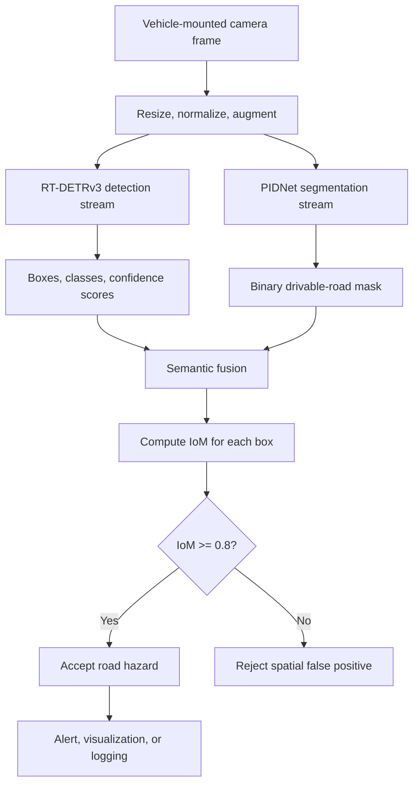

# Context-Aware Pothole Detection Using RT-DETRv3 and PIDNet Semantic Fusion

## A Semester Research Thesis

**Submitted in partial fulfillment of the requirements for the award of the degree of Bachelor of Technology**  
**Department of Information Technology**  
**Indian Institute of Information Technology Allahabad**

### Authors

- **Abhishek Singh** — IIB2023017
- **Raj Verma** — IIB2023026
- **Nidhi Kumari** — IIB2023037

**Submission date:** March 8, 2026  
**Supervisor:** *To be completed before submission*

> **Document status:** This Markdown thesis is an organized research draft based on the supplied thesis-document extraction. It replaces template placeholders with the project information available in the source material, but supervisor details, verified experimental measurements, final formatting, and institutional approval information must still be completed before formal submission.

---

## Certificate

This is to certify that the work contained in the thesis titled **“Context-Aware Pothole Detection Using RT-DETRv3 and PIDNet Semantic Fusion”**, submitted by **Abhishek Singh (IIB2023017), Raj Verma (IIB2023026), and Nidhi Kumari (IIB2023037)**, has been carried out under my supervision and has not been submitted elsewhere for the award of any degree.

**Supervisor:** *To be completed*  
**Department of Information Technology**  
**Indian Institute of Information Technology Allahabad**

Signature: ____________________  
Date: _________________________

---

## Candidate Declaration

We, **Abhishek Singh (IIB2023017), Raj Verma (IIB2023026), and Nidhi Kumari (IIB2023037)**, declare that this thesis titled **“Context-Aware Pothole Detection Using RT-DETRv3 and PIDNet Semantic Fusion”** is submitted in partial fulfillment of the requirements for the Degree of Bachelor of Technology in the Department of Information Technology at the Indian Institute of Information Technology Allahabad.

We acknowledge that plagiarism includes reproducing another person's work or ideas without appropriate attribution, copying or paraphrasing another person's work without citation, and reproducing unique literary or technical content without crediting its source.

We affirm that appropriate credit has been given to all original authors and sources for words, ideas, diagrams, graphics, computer programs, experiments, results, and websites that are not our own contributions. Direct quotations, where used, must be clearly marked, and all sources must be cited. We declare that no portion of this thesis is knowingly plagiarized. In the event of a plagiarism claim, we accept responsibility for the contents of this thesis.

**Place:** _____________________  
**Date:** ______________________

| Student | Roll number | Signature |
|---|---|---|
| Abhishek Singh | IIB2023017 | __________________ |
| Raj Verma | IIB2023026 | __________________ |
| Nidhi Kumari | IIB2023037 | __________________ |

---

## Abstract

Road surface damage such as potholes and cracks can lead to traffic accidents, vehicle damage, and increased road-maintenance costs. Traditional road inspection methods rely on manual surveys, which are time-consuming, expensive, and difficult to scale. Recent developments in deep learning and computer vision have enabled automated road-damage detection using images captured by vehicle-mounted cameras. However, many detection systems still produce false detections in complex road environments because shadows, road markings, oil stains, puddles, and background textures can resemble potholes.

This thesis proposes **RoadAware-DETR**, a context-aware pothole-detection framework that combines **RT-DETRv3** for object detection with **PIDNet** semantic segmentation for drivable-road identification. RT-DETRv3 produces candidate hazard bounding boxes, while PIDNet generates a pixel-level road mask. A spatial validation layer then measures the proportion of each predicted bounding box that overlaps the drivable-road region. Detections that do not satisfy the proposed road-context threshold are filtered as spatially invalid predictions.

The proposed system is designed as a parallel dual-stream pipeline consisting of input preprocessing, weather augmentation, RT-DETRv3 detection, PIDNet segmentation, semantic fusion, and false-positive filtering. The project considers clear, rainy, foggy, shadowed, and low-light conditions to improve robustness in real-world environments. RDD2022 is used as the public road-damage baseline, with a planned supplementary weather-diverse dataset for adverse-condition analysis.

The research is intended to reduce off-road false positives and improve the reliability of road-hazard perception. The supplied project material describes expected outcomes, but does not provide verified numerical measurements. Therefore, this thesis reports the proposed methodology and evaluation plan without inventing experimental results.

**Keywords:** pothole detection, RT-DETRv3, PIDNet, semantic segmentation, road damage detection, semantic fusion, drivable-area estimation, false-positive filtering, adverse weather, autonomous driving.

---

## Acknowledgements

The authors would like to express their sincere gratitude to the Department of Information Technology, Indian Institute of Information Technology Allahabad, for providing the academic environment and resources required for this project.

The authors also thank the project supervisor, whose name and designation should be added before final submission, for guidance and feedback throughout the research process. We acknowledge the authors and maintainers of RT-DETRv3, PIDNet, RDD2022, and the related research works used as foundations for this project.

Finally, we thank our colleagues, friends, and family members for their encouragement and support.

---

## Table of Contents

1. [Introduction](#1-introduction)
2. [Literature Review](#2-literature-review)
3. [Proposed Methodology](#3-proposed-methodology)
4. [Experimental Setup and Dataset](#4-experimental-setup-and-dataset)
5. [Results and Discussion Plan](#5-results-and-discussion-plan)
6. [Expected Outcomes and Future Work](#6-expected-outcomes-and-future-work)
7. [Conclusion](#7-conclusion)
8. [Bibliography](#bibliography)

---

## List of Abbreviations

| Abbreviation | Meaning |
|---|---|
| CNN | Convolutional Neural Network |
| DETR | Detection Transformer |
| RT-DETR | Real-Time Detection Transformer |
| RT-DETRv3 | Real-Time Detection Transformer Version 3 |
| PIDNet | Proportional–Integral–Derivative Network |
| IoU | Intersection over Union |
| IoM | Intersection over Mask |
| TP | True Positive |
| FP | False Positive |
| FN | False Negative |
| mAP | Mean Average Precision |
| FPS | Frames Per Second |
| YOLO | You Only Look Once |
| RDD | Road Damage Dataset |
| FDR | False Discovery Rate |
| NMS | Non-Maximum Suppression |

---

## List of Symbols

| Symbol | Description |
|---|---|
| \(B_p\) | Predicted bounding box generated by the detector |
| \(B_{gt}\) | Ground-truth bounding box from annotations |
| \(B\) | Detection bounding box used during semantic fusion |
| \(M\) | Drivable-road segmentation mask produced by PIDNet |
| \(\operatorname{Area}(\cdot)\) | Area of a region or bounding box |
| \(B \cap M\) | Region shared by the detection box and the road mask |
| \(B_p \cup B_{gt}\) | Union of predicted and ground-truth boxes |
| \(N\) | Number of object classes |
| \(AP_i\) | Average Precision for class \(i\) |
| \(\tau\) | Semantic-fusion acceptance threshold |

---

# 1. Introduction

## 1.1 Background

Road infrastructure is an essential component of modern transportation systems. Maintaining road quality is important for comfortable travel, vehicle safety, and the reduction of traffic accidents and maintenance costs. Among different types of road defects, potholes are common and potentially dangerous. They can be formed by water infiltration, temperature changes, repeated heavy-vehicle loading, and progressive pavement deterioration.

If potholes are not detected and repaired in time, they may cause tire punctures, suspension damage, loss of vehicle control, and accidents involving vehicles or two-wheelers. Transportation authorities therefore require reliable methods for monitoring road conditions and locating defects at an early stage.

Traditional road inspection is generally performed by maintenance teams that visually inspect road surfaces and record the locations of defects. Although manual inspection can be effective, it is labor-intensive, time-consuming, difficult to scale across large road networks, and potentially dangerous for inspectors working near moving traffic.

Computer vision provides an opportunity to automate road inspection using cameras mounted on vehicles or drones. Deep-learning models can learn visual patterns associated with cracks and potholes directly from annotated images. However, an image-only detector may identify a pothole-like appearance without understanding whether that appearance belongs to the road surface.

## 1.2 Problem Statement

Context-free road-damage detectors may generate false positives for cracks, shadows, puddles, oil stains, manhole covers, or textures located on sidewalks, medians, dirt shoulders, or other non-drivable regions. In an autonomous or driver-assistance system, such detections can be interpreted as immediate road hazards and may trigger unnecessary warnings or emergency braking, a phenomenon commonly called phantom braking.

The central research problem is therefore:

> How can a real-time pothole detector use drivable-area context to distinguish true on-road hazards from visually similar off-road anomalies?

## 1.3 Objectives

The objectives of this research are:

1. To detect potholes and cracks using RT-DETRv3.
2. To estimate the drivable road surface using PIDNet semantic segmentation.
3. To design a semantic-fusion layer that validates detections against the road mask.
4. To reduce spatially invalid false positives.
5. To study robustness under rain, fog, shadows, and low-light conditions.
6. To define a reproducible evaluation plan using detection, segmentation, and safety-oriented metrics.

## 1.4 Contributions

The proposed project contributes:

- A dual-stream road-awareness architecture combining object detection and semantic segmentation.
- A geometric IoM-based validation rule for filtering off-road detections.
- An adverse-weather training and evaluation plan.
- A framework for comparing ordinary detection with context-aware detection.
- An implementation direction suitable for vehicle-mounted camera and intelligent-transportation applications.

---

# 2. Literature Review

## 2.1 Traditional Road-Damage Detection

Early automated road-inspection systems used edge detection, texture analysis, thresholding, and handcrafted image features. These methods were computationally inexpensive but highly sensitive to lighting, shadows, camera quality, road materials, and environmental changes.

## 2.2 CNN-Based Detection

Deep convolutional detectors such as YOLO, Faster R-CNN, and SSD improved road-damage detection by learning visual features from data. YOLO-family models became popular for real-time use because of their speed. Research such as POT-YOLO and MSFYOLO explored boundary refinement and multi-scale feature fusion for potholes and small damage regions.

Despite their effectiveness, convolutional detectors may rely heavily on local visual patterns. A shadow or surface texture can therefore resemble a pothole, especially when the scene contains complex road backgrounds.

## 2.3 Transformer-Based Detection

The Detection Transformer introduced self-attention into object detection and enabled models to capture relationships between distant image regions. The original DETR architecture, however, required long training schedules and significant computation. RT-DETR improved real-time performance through architectural and query-selection optimizations.

RT-DETRv3 further introduced Hierarchical Dense Positive Supervision, providing richer supervision during training. This is particularly relevant to pothole detection because potholes and cracks can be small, irregular, and difficult to localize.

## 2.4 Semantic Segmentation for Road Context

Semantic segmentation assigns a class label to each image pixel. PIDNet uses a three-branch design inspired by proportional, integral, and derivative control to balance detail preservation, contextual understanding, and boundary refinement. Its road mask can provide the spatial context missing from a detector-only system.

## 2.5 Adverse Weather Robustness

Real-world road images may be captured in rain, fog, shadows, low illumination, and wet-road reflections. Weather augmentation and weather-diverse training data can improve generalization by exposing the model to visual variations that are absent from standard datasets.

## 2.6 Research Gap

Many pothole-detection systems focus primarily on visual detection accuracy. They do not explicitly enforce the condition that a detected hazard must lie on the drivable surface. RoadAware-DETR addresses this gap by combining RT-DETRv3 localization with PIDNet road-context segmentation and a spatial validation rule.

---

# 3. Proposed Methodology

## 3.1 System Overview

The proposed architecture is a parallel dual-stream perception pipeline. A vehicle-mounted camera provides an input frame. The frame is preprocessed and sent simultaneously to:

- an RT-DETRv3 detector for hazard localization, and
- a PIDNet segmenter for drivable-road estimation.

The outputs are passed to a semantic-fusion layer. Each detection is assigned an IoM score, and the score is compared with a proposed acceptance threshold.



## 3.2 Input Preprocessing and Weather Augmentation

Input images are resized and normalized to meet model requirements. Training augmentation may include brightness changes, contrast changes, blur, rain simulation, fog simulation, shadow overlays, and low-light transformations. Augmentation should be applied consistently while preserving bounding-box and segmentation-mask validity.

## 3.3 Pothole Detection Using RT-DETRv3

RT-DETRv3 is used to produce candidate hazard detections. For each detected object, the detector returns a class label, confidence score, and bounding box. The model is suitable for this project because it is designed for real-time end-to-end detection and does not require a conventional NMS post-processing stage.

The project adopts the following conceptual loss decomposition from the source thesis:

\[
\mathcal{L}_{total} = \lambda_1\mathcal{L}_{aux} + \lambda_2\mathcal{L}_{one-to-one} + \lambda_3\mathcal{L}_{one-to-many}
\]

where the coefficients \(\lambda_1\), \(\lambda_2\), and \(\lambda_3\) control the contributions of auxiliary, one-to-one, and one-to-many supervision terms. Exact values should be taken from the selected RT-DETRv3 configuration rather than assumed in this thesis.

## 3.4 Road Segmentation Using PIDNet

PIDNet generates a pixel-level semantic mask. For the simplest version of the project, the mask is binary:

- `1`: drivable road surface
- `0`: non-drivable region

The three conceptual branches are:

- **P-Branch:** preserves high-resolution spatial details.
- **I-Branch:** aggregates global context and helps identify road boundaries.
- **D-Branch:** refines boundaries and reduces mask overshoot into sidewalks or curbs.

## 3.5 Intersection over Union for Detection Evaluation

IoU compares a predicted bounding box with its ground-truth box:

\[
IoU = \frac{\operatorname{Area}(B_p \cap B_{gt})}{\operatorname{Area}(B_p \cup B_{gt})}
\]

IoU is used for standard object-detection evaluation and for deciding whether a predicted object matches a ground-truth annotation.

## 3.6 Intersection over Mask for Context Validation

For semantic fusion, the proposed metric is the fraction of the detection box that lies on the drivable road mask:

\[
IoM = \frac{\operatorname{Area}(B \cap M)}{\operatorname{Area}(B)}
\]

Here, \(B\) is the predicted detection box and \(M\) is the binary road mask. This definition is preferred for context validation because it directly answers: “What fraction of the predicted hazard box lies on the road?”

The acceptance rule is:

\[
\operatorname{Status}(B) =
\begin{cases}
\operatorname{Valid}, & \text{if } IoM \geq \tau \\
\operatorname{Discard}, & \text{if } IoM < \tau
\end{cases}
\]

with the initial proposed threshold:

\[
\tau = 0.8
\]

The threshold is a project hypothesis and must be tuned using validation data. It should not be described as a universally optimal or independently validated value.

## 3.7 Fusion Algorithm

```python
import numpy as np


def compute_iom(box, road_mask):
    """Return the fraction of a detection box covered by road pixels.

    Args:
        box: Iterable [x1, y1, x2, y2].
        road_mask: HxW binary or boolean array; nonzero means drivable road.
    """
    x1, y1, x2, y2 = map(int, box)
    height, width = road_mask.shape[:2]

    x1 = max(0, min(x1, width))
    y1 = max(0, min(y1, height))
    x2 = max(0, min(x2, width))
    y2 = max(0, min(y2, height))

    if x2 <= x1 or y2 <= y1:
        return 0.0

    roi = road_mask[y1:y2, x1:x2]
    box_area = (x2 - x1) * (y2 - y1)
    if box_area == 0:
        return 0.0

    road_pixels = np.count_nonzero(roi)
    return float(road_pixels / box_area)


def filter_detections(detections, road_mask, threshold=0.8):
    """Split detections into accepted and rejected predictions."""
    accepted, rejected = [], []

    for detection in detections:
        score = float(detection["score"])
        iom = compute_iom(detection["bbox"], road_mask)
        result = {**detection, "iom": iom}

        if iom >= threshold:
            result["status"] = "accepted"
            accepted.append(result)
        else:
            result["status"] = "rejected"
            rejected.append(result)

    return accepted, rejected
```

---

# 4. Experimental Setup and Dataset

## 4.1 Public Baseline: RDD2022

The Road Damage Detection Dataset 2022 is used as the public road-damage baseline. The supplied project material describes RDD2022 as containing road images from Japan, India, the Czech Republic, Norway, the United States, and China, with more than 47,000 images and more than 55,000 annotated road-damage instances.

The project considers the following damage categories:

- Longitudinal crack (D00)
- Transverse crack (D10)
- Alligator crack (D20)
- Pothole (D40)
- Other road-surface damage, depending on the selected release and label mapping

The original dataset release, exact counts, label definitions, and license must be verified before final thesis submission or redistribution.

**Dataset resources:**

- RDD2022 repository: <https://github.com/sekilab/RoadDamageDetector>
- RDD2022 paper: <https://arxiv.org/abs/2209.08538>

## 4.2 Geographic Subsets

The source thesis proposes using India and Japan subsets because they contain varied road conditions and urban artifacts. The final experiment must document the exact image counts, train/validation/test split, and whether the split is geographic, temporal, or random.

## 4.3 Weather-Diverse Data

A supplementary dataset is proposed to study environmental robustness:

- **Sunny:** strong illumination and deep shadows.
- **Rainy:** wet surfaces and specular reflections.
- **Foggy or low-contrast:** reduced visibility and weaker boundaries.
- **Low-light:** night or dim scenes illuminated by vehicle headlights.

If a custom dataset is created, the final thesis should document the collection protocol, consent and privacy considerations, camera specifications, geographic coverage, annotation procedure, and license.

## 4.4 Model Resources

- RT-DETRv3 repository: <https://github.com/clxia12/RT-DETRv3>
- RT-DETRv3 paper: <https://arxiv.org/abs/2409.08475>
- PIDNet repository: <https://github.com/XuJiacong/PIDNet>

This project repository is a documentation and implementation workspace. RT-DETRv3 and PIDNet may be integrated as external dependencies, submodules, or adapted components. Their original licenses and installation requirements must be followed.

## 4.5 Proposed Experimental Configurations

| Configuration | Detector | Segmenter | Fusion | Purpose |
|---|---|---|---|---|
| Baseline A | RT-DETRv3 | None | None | Measure detector-only performance |
| Baseline B | RT-DETRv3 | PIDNet | Disabled | Measure two-stream cost without filtering |
| Proposed | RT-DETRv3 | PIDNet | IoM threshold | Measure context-aware filtering |
| Ablation 1 | RT-DETRv3 | PIDNet | Vary \(\tau\) | Study threshold sensitivity |
| Ablation 2 | RT-DETRv3 | PIDNet | Weather-specific | Study robustness across conditions |

## 4.6 Evaluation Metrics

### Precision

\[
Precision = \frac{TP}{TP + FP}
\]

Precision measures the proportion of predicted positives that are correct.

### Recall

\[
Recall = \frac{TP}{TP + FN}
\]

Recall measures the proportion of relevant hazards that are detected.

### F1-score

\[
F1 = 2 \times \frac{Precision \times Recall}{Precision + Recall}
\]

### Mean Average Precision

For \(N\) classes:

\[
mAP = \frac{1}{N}\sum_{i=1}^{N} AP_i
\]

The final thesis should explicitly state whether mAP@50, mAP@50:95, or another evaluation protocol is used.

### False Discovery Rate

\[
FDR = \frac{FP}{TP + FP}
\]

For the context-aware analysis, the project should report both ordinary detection false positives and spatially invalid detections rejected by the IoM filter.

### Segmentation Metrics

PIDNet should be evaluated using suitable segmentation metrics such as:

- mean Intersection over Union (mIoU),
- pixel accuracy,
- class-wise IoU, and
- boundary quality where appropriate.

### Context Metrics

The following context-specific analyses are recommended:

- accepted versus rejected detection counts,
- IoM distribution for true and false detections,
- FDR before and after fusion,
- false-positive reduction percentage,
- threshold-sensitivity curves,
- weather-wise IoM performance.

## 4.7 Reproducibility Requirements

The final experiment log should record:

- dataset release and download source,
- exact train/validation/test split,
- image resolution,
- augmentation settings,
- model configuration and pretrained weights,
- hardware and software versions,
- number of training epochs,
- optimizer and learning-rate settings,
- confidence threshold and IoM threshold,
- inference latency and FPS measurement procedure.

---

# 5. Results and Discussion Plan

The supplied thesis material describes expected outcomes but does not provide verified numerical results. This chapter is therefore a reporting template rather than a claim of completed experiments.

## 5.1 Detection Results Table

| Model | Dataset split | Precision | Recall | mAP@50 | mAP@50:95 | FPS |
|---|---|---:|---:|---:|---:|---:|
| RT-DETRv3 baseline | To be filled | — | — | — | — | — |
| RoadAware-DETR | To be filled | — | — | — | — | — |

## 5.2 Semantic-Fusion Results Table

| Configuration | IoM threshold | Total detections | Accepted | Rejected | FDR before | FDR after | False-positive reduction |
|---|---:|---:|---:|---:|---:|---:|---:|
| Detector only | N/A | — | N/A | N/A | — | N/A | N/A |
| RoadAware-DETR | 0.80 | — | — | — | — | — | — |

## 5.3 Weather-Wise Results Table

| Condition | Precision | Recall | mAP | FDR | mIoU | FPS |
|---|---:|---:|---:|---:|---:|---:|
| Sunny | — | — | — | — | — | — |
| Rainy | — | — | — | — | — | — |
| Foggy | — | — | — | — | — | — |
| Low-light | — | — | — | — | — | — |

## 5.4 Expected Discussion

The proposed framework is expected to reduce false detections caused by non-road artifacts because detections outside the drivable surface should receive low IoM scores and be removed. It is also expected to improve robustness in adverse weather when weather-diverse data and suitable augmentation are used.

These statements are hypotheses to be tested. The final thesis must replace the tables and discussion with measured results, confidence intervals or repeated-run statistics where appropriate, and an explanation of failure cases.

## 5.5 Failure-Case Analysis

The final analysis should include examples of:

- a true pothole accepted by both detector and road mask,
- an off-road visual artifact rejected by IoM filtering,
- a pothole missed by RT-DETRv3,
- a segmentation error that incorrectly rejects an on-road pothole,
- a rainy or low-light image in which both streams fail.

---

# 6. Expected Outcomes and Future Work

## 6.1 Expected Outcomes

The expected outcomes of the research are:

1. A reduction in false positives caused by shadows, manhole covers, oil stains, road markings, and sidewalk textures.
2. Improved spatial reliability through road-mask validation.
3. Better understanding of the trade-off between filtering false positives and accidentally rejecting valid hazards.
4. Improved robustness under rainy, foggy, shadowed, and low-light conditions.
5. A reproducible baseline for context-aware road-damage detection.

## 6.2 Limitations

- The IoM threshold of 0.8 is a proposed starting point and requires calibration.
- Fusion quality depends on the accuracy and spatial alignment of PIDNet masks.
- A box-level road test may not perfectly represent the physical location of every pothole.
- Weather augmentation may not reproduce all real-world conditions.
- Different cameras, countries, road materials, and driving speeds can change performance.
- The system should not be used as a sole safety authority without vehicle-level validation and human oversight.

## 6.3 Future Work

Future work includes:

- collecting and annotating a dedicated drivable-road segmentation dataset;
- calibrating the IoM threshold using validation data;
- comparing box-area IoM with alternative mask-overlap definitions;
- adding temporal tracking across consecutive frames;
- using camera calibration and perspective geometry to estimate hazard position;
- evaluating on broader geographic and weather distributions;
- measuring end-to-end latency on edge hardware;
- investigating uncertainty estimation and confidence calibration;
- studying the impact of false-positive reduction on driver-assistance safety;
- integrating the pipeline with a simulator before any real-vehicle deployment.

---

# 7. Conclusion

This thesis proposes RoadAware-DETR, a context-aware pothole-detection framework that combines RT-DETRv3 object detection with PIDNet semantic segmentation. RT-DETRv3 identifies candidate road damage, while PIDNet provides a drivable-road mask that supplies the spatial context missing from detector-only systems. The semantic-fusion layer computes an IoM score for each detection and uses a proposed threshold of 0.8 to accept or reject the hazard.

The approach is designed to reduce off-road false positives and improve the reliability of automated road monitoring under complex environmental conditions. RDD2022 provides a public road-damage foundation, while weather-diverse data supports robustness analysis. The project provides a clear experimental plan, but verified numerical results must be added after the planned experiments are completed.

---

# Bibliography

1. J. Xu et al., “PIDNet: A Real-Time Semantic Segmentation Network Inspired by PID Controllers,” *Proceedings of the IEEE/CVF Conference on Computer Vision and Pattern Recognition*, 2023.
2. S. Wang, C. Xia, F. Lv, and Y. Shi, “RT-DETRv3: Real-time End-to-End Object Detection with Hierarchical Dense Positive Supervision,” *Proceedings of the IEEE/CVF Winter Conference on Applications of Computer Vision*, 2025. Available: <https://arxiv.org/abs/2409.08475>
3. Y. Li et al., “A Road Damage Detection Model Based on Improved RT-DETR for Complex Environments,” *IEEE Access*, 2024. Verify bibliographic details before final submission.
4. H. Zhang et al., “Crack-DETR: Complex Pavement Crack Detection by Multifrequency Feature Extraction and Fusion,” *IEEE Transactions on Intelligent Transportation Systems*, 2024. Verify bibliographic details before final submission.
5. S. Patel et al., “POT-YOLO: Real-Time Road Potholes Detection Using Edge Segmentation-Based YOLOv8 Network,” *IEEE Sensors Journal*, 2024. Verify bibliographic details before final submission.
6. Y. Chen et al., “MSFYOLO: Feature Fusion-Based Detection for Small Objects,” *IEEE Access*, 2023. Verify bibliographic details before final submission.
7. J. Wang et al., “Two-Step Method of Pavement Pothole and Raveling Detection and Segmentation Based on Deep Learning,” *IEEE Access*, 2022. Verify bibliographic details before final submission.
8. A. Kortylewski et al., “Time to Shine: Fine-Tuning Object Detection Models with Synthetic Adverse Weather Images,” *CVPR Workshops*, 2023. Verify bibliographic details before final submission.
9. M. Kim et al., “L-DETR: A Lightweight Detector for End-to-End Object Detection With Transformers,” *IEEE Access*, 2023. Verify bibliographic details before final submission.
10. L. Wang et al., “DETRs Beat YOLOs on Real-time Object Detection,” *Proceedings of the IEEE/CVF Conference on Computer Vision and Pattern Recognition*, 2024. Verify bibliographic details before final submission.
11. Sekilab, “RoadDamageDetector: Road Damage Detection Dataset and Related Resources.” Available: <https://github.com/sekilab/RoadDamageDetector>
12. RT-DETRv3 project repository. Available: <https://github.com/clxia12/RT-DETRv3>
13. PIDNet project repository. Available: <https://github.com/XuJiacong/PIDNet>

---

## Submission Checklist

Before submitting the formal thesis, complete the following:

- [ ] Add the supervisor's correct name, title, and signature fields.
- [ ] Confirm all author names and roll numbers.
- [ ] Replace all remaining placeholders in the institutional thesis template.
- [ ] Generate a correct table of contents from the final document.
- [ ] Add final figures, architecture diagrams, and captions.
- [ ] Add verified experimental results and statistical analysis.
- [ ] Document the exact datasets, versions, splits, and licenses.
- [ ] Verify every bibliography entry and DOI or URL.
- [ ] Add a Chapter 5 if the institutional format requires a separate results chapter.
- [ ] Run plagiarism and citation checks according to institute requirements.
- [ ] Export the final document to the required PDF format.
